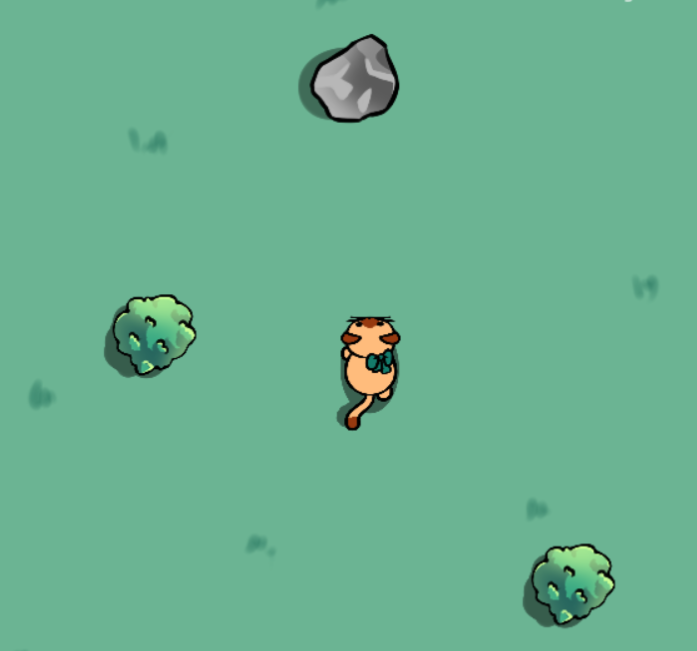

# Kitten Adventure

A small 2D game created with Godot Engine in 2018 as my first video game project.

## Play the Game

<table>
  <tr>
    <td width="180">
      
    </td>
    <td>
      <h3>Kitten Adventure (2018)</h3>
      
A small 2D game created with Godot in 2018 as my first video game project.

      <a href="https://roxy-gaming.itch.io/kitten-adventure">Play on itch.io ↗</a>
    </td>
  </tr>
</table>

## About the Project

Kitten Adventure was originally created in 2018 for a girls' camp. It was a simple 2D game developed while exploring game development with Godot. The original version focused on moving a kitten around a garden and avoiding obstacles.

In 2026, I returned to the project to improve the gameplay, add new mechanics, and practise my programming skills as part of my journey back into software development.

## What's New in 2026

The updated version expands on the original game with several new features:

- **Random obstacle generation:** Obstacles spawn at different positions, making each playthrough less predictable.
- **Life system:** The kitten has three lives, displayed as fish icons on the screen.
- **Healing fish:** Collectible fish restore lost lives and only spawn when the kitten is missing a life.
- **Countdown timer:** Survive for 60 seconds to complete the game.
- **Victory overlay:** When the timer reaches zero, the game pauses and displays a victory message before returning to the main menu.
- **Game Over screen:** Losing all three lives ends the game.
- **Improved collision detection:** Collision shapes were adjusted to make collisions feel fairer.
- **Updated user interface:** The game includes a main menu with instructions, a timer, life indicators, and victory and Game Over feedback.

These improvements turned the original simple game into a more complete playable experience while giving me the opportunity to revisit an older project and practise programming concepts.

## Controls

Use the arrow keys to move the kitten:

- **Up Arrow:** Move up
- **Down Arrow:** Move down
- **Left Arrow:** Move left
- **Right Arrow:** Move right

## How to Play

1. Start the game from the main menu.
2. Avoid bushes, rocks, and lakes.
3. Avoid collisions to preserve your three lives.
4. Collect healing fish when you have lost a life.
5. Survive for 60 seconds to win!

## Built With

- **Godot Engine 3.0.4**
- **GDScript**

## What I Practised

Revisiting this project gave me practical experience with:

- GDScript and game logic
- Scene management and transitions
- Collision detection and physics
- Signals and node references
- Randomised object spawning
- Timers, pausing, and game states
- Updating the user interface dynamically
- Debugging and improving an existing project

## Source Code

The source code is available in this repository for anyone interested in exploring how the game was made.

If you're new to Godot, feel free to use this project as a starting point to experiment with the engine, explore its scenes and scripts, and try your own modifications or improvements.

## Learning Resources

The original game was developed while following the Spanish tutorial *Tutorial Godot: Mi Primer Videojuego*, which documents the development process step by step.
